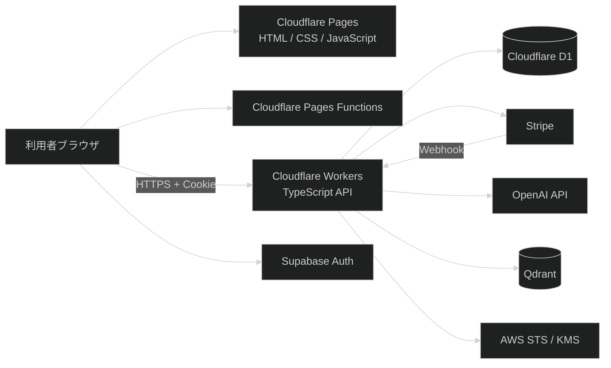
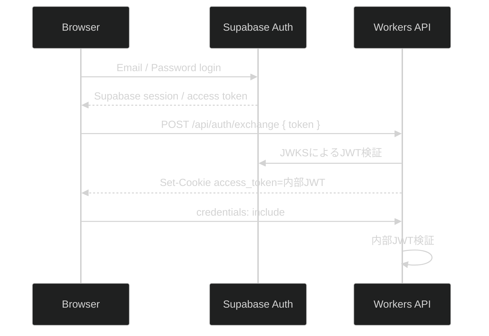

# 現行システム棚卸し

> 調査対象: `fractal-filix/shadowwork-navigator`
>
> 対象ブランチ: `main`
>
> 対象コミット: `554a1cf22630ac5756bc9f9c3835d5c698d90258`
>
> 調査日: 2026-07-20

## 本書の位置づけ

本書は、現行リポジトリに存在するコード、設定、テストおよびドキュメントを静的に調査し、**現在のシステムがどのような状態になっているか**を記録するものである。

本書では、サービスの目的、想定利用者、業務要求、機能要件、非機能要件および「システムがどうあるべきか」は定義しない。それらは現行成果物から逆算せず、別途ゼロベースで検討する。

### 調査上の表記

| 表記 | 意味 |
|---|---|
| 実装確認 | 現行コードに処理が存在する |
| 接続確認 | 通常の画面導線から処理が呼び出されている |
| ドキュメント記載 | 文書には記載があるが、実装・接続の確認とは別 |
| 未確認 | リポジトリの静的調査だけでは確認できない |
| 不一致 | コード、設定、画面文言、ドキュメント等の間で内容が一致しない |

---

## 1. 調査対象と調査基準

### 1.1 調査対象

- ルート設定
  - `README.md`
  - `package.json`
  - `pnpm-workspace.yaml`
  - `.github/copilot-instructions.md`
- Webアプリ
  - `apps/web/pages/`
  - `apps/web/functions/`
  - `apps/web/tests/`
  - `apps/web/package.json`
- API
  - `apps/api/src/`
  - `apps/api/database/DDL.sql`
  - `apps/api/tests/`
  - `apps/api/scripts/`
  - `apps/api/package.json`
  - `apps/api/tsconfig.json`
  - `apps/api/wrangler.toml`
- 既存ドキュメント
  - `apps/api/documents/基本設計書/`
  - `docs/phases/`
  - 各README、runbook、試験資料

### 1.2 調査基準

本書では、次の優先順位で現状を判定した。

1. 実行コード
2. DDL・実行設定
3. テストコード
4. README・基本設計書・runbook等の文書

コードと文書が不一致の場合は、コードを「現行実装」、文書を「現行文書」として別々に記録した。

### 1.3 調査対象外

以下は確認していない。

- Cloudflare Pages／Workers管理画面の実設定
- Cloudflare D1の実スキーマ・実データ
- Supabase管理画面の認証設定
- Stripeの商品、Price、Webhook、決済実績
- Qdrant CloudのCollection・実データ
- AWS IAM、STS、KMS、CloudTrailの実設定
- 本番環境・staging環境での実動作
- 実ユーザー、アクセス数、障害、費用

---

## 2. リポジトリ構成

```text
shadowwork-navigator/
├─ .github/
│  └─ copilot-instructions.md
├─ apps/
│  ├─ web/
│  │  ├─ functions/
│  │  │  ├─ runtime-config.js.ts
│  │  │  └─ tokushoho.html.ts
│  │  ├─ pages/
│  │  │  ├─ index.html
│  │  │  ├─ purchase.html
│  │  │  ├─ thanks.html
│  │  │  ├─ dashboard.html
│  │  │  ├─ app.html
│  │  │  ├─ terms.html
│  │  │  ├─ privacy.html
│  │  │  └─ lib/
│  │  ├─ tests/
│  │  ├─ package.json
│  │  └─ README.md
│  └─ api/
│     ├─ .github/workflows/docs.yml
│     ├─ database/DDL.sql
│     ├─ documents/基本設計書/
│     ├─ scripts/
│     ├─ src/
│     │  ├─ handlers/
│     │  ├─ lib/
│     │  ├─ types/
│     │  ├─ routes.ts
│     │  └─ worker.ts
│     ├─ tests/
│     ├─ package.json
│     ├─ tsconfig.json
│     └─ wrangler.toml
├─ docs/phases/
├─ packages/
├─ package.json
├─ pnpm-lock.yaml
└─ pnpm-workspace.yaml
```

### 2.1 モノレポ構成

- pnpm Workspaceを使用している。
- Workspace対象は`apps/*`と`packages/*`である。
- `apps/web`と`apps/api`が実アプリとして存在する。
- `packages/*`はREADME上「shared packages (reserved)」とされているが、現行コードから共有パッケージの利用は確認できない。

### 2.2 GitHub関連ファイル

- ルートの`.github/copilot-instructions.md`に、TDD、秘密情報の扱い、PR単位、レビュー方法等が記載されている。
- `apps/api/.github/workflows/docs.yml`にMkDocsのGitHub Pages配備workflowが存在する。
- workflowファイルはリポジトリルートの`.github/workflows/`ではなく`apps/api/.github/workflows/`にあるため、通常のGitHub Actions workflowとして認識される配置ではない。
- 対象コミットに紐づくGitHub Actions workflow runおよびcommit statusは、コネクタから確認できなかった。

---

## 3. 技術スタックと依存ライブラリ

### 3.1 リポジトリ・パッケージ管理

| 項目 | 現状 |
|---|---|
| パッケージマネージャー | pnpm `9.15.9` |
| 構成 | pnpm Workspaceによるモノレポ |
| ルートbuild | `pnpm -r build` |
| ルートtypecheck | `pnpm -r typecheck` |
| ルートlint | `pnpm -r lint` |

### 3.2 Web

| 項目 | 現状 |
|---|---|
| UI | HTML、CSS、Vanilla JavaScript |
| モジュール方式 | ブラウザES Modules |
| フレームワーク | React、Vue、Angular等は未使用 |
| 認証クライアント | Supabase JavaScript UMD版をjsDelivrから読込 |
| API通信 | ブラウザ標準`fetch` |
| 暗号 | Web Crypto API |
| 配信 | Cloudflare Pages |
| 動的処理 | Cloudflare Pages Functions |
| Web build | なし。`pages`ディレクトリをそのまま配信 |
| Web typecheck | package scriptはskip |
| Web lint | package scriptはskip |

Supabase JavaScriptのCDN URLはバージョン番号を固定していない。

### 3.3 API

| 項目 | 現状 |
|---|---|
| 実行基盤 | Cloudflare Workers |
| 言語 | TypeScript |
| module | ES Modules |
| TypeScript | `5.9.3` |
| target/module | ESNext |
| strict | 有効 |
| バンドラー | esbuild |
| 配備・開発 | Wrangler |
| Router | 自作の完全一致Router |
| DBアクセス | Cloudflare D1 APIへSQLを直接記述 |
| 外部API連携 | SDKよりも`fetch`によるREST API直結が中心 |
| JWT | Supabase JWT検証に`jose`、内部JWTはWeb Cryptoで自作 |
| テスト | Node.js標準`node:test`、Miniflare |

### 3.4 主な外部技術

- Cloudflare Pages
- Cloudflare Pages Functions
- Cloudflare Workers
- Cloudflare D1
- Supabase Auth
- Stripe Checkout／Webhook
- OpenAI Responses API
- OpenAI Embeddings API
- Qdrant
- AWS STS／KMS

### 3.5 依存関係の現状

- `jose`はルート`package.json`にあるが、実際の使用箇所は`apps/api`である。
- `apps/api/package.json`には、ソースコードで明示的に使用しているもの以外にも多数の低レベルパッケージが直接dependenciesとして列挙されている。
- `apps/api/package.json`のrepository、bugs、homepageは、統合前と思われる`filix-shadowwork-api`リポジトリを指したままである。
- API側に`typecheck`および`lint`スクリプトは存在しない。

---

## 4. 実行環境・インフラ構成

### 4.1 全体構成



### 4.2 Web環境

- Production URLとして`https://shadowwork-navigator.com`がREADMEに記載されている。
- Cloudflare Pages URLとして`https://shadowwork-navigator.pages.dev`が記載されている。
- Production branchは`production`と記載されている。
- Root directoryは`apps/web`、Output directoryは`pages`である。
- Web専用のbuild commandはない。
- Pages Functionsが`runtime-config.js`と`tokushoho.html`を動的生成する。

### 4.3 API環境

- staging Worker名: `filix-shadowwork-api-staging`
- production Worker名: `filix-shadowwork-api`
- production custom domain: `api.shadowwork-navigator.com`
- `workers_dev = true`
- `preview_urls = true`
- `compatibility_date = 2026-01-02`

### 4.4 D1環境

| 環境 | binding | DB名 |
|---|---|---|
| staging | `DB` | `filix_shadowwork_stg` |
| production | `DB` | `filix_shadowwork_prod` |

`wrangler.toml`のトップレベルにはD1 bindingがなく、`staging`と`production`にだけ定義されている。一方、`dev` scriptは単に`wrangler dev`であり、環境指定は含まれていない。

### 4.5 環境分離

- stagingとproductionでD1、Supabase URL、Supabase JWKS、CORS Originが分離されている。
- QdrantのURL・Collectionは`wrangler.toml`には実値を書かず、Cloudflare側で環境別に管理する想定である。
- AWS、Stripe、OpenAI等の実値はリポジトリからは確認できない。

---

## 5. 現在存在する画面

| パス | 実装 | 現在の内容 |
|---|---|---|
| `/`、`/index.html` | `pages/index.html` | サービス紹介、Email／Passwordログイン、ログアウト、Dashboard導線 |
| `/purchase.html` | `pages/purchase.html` | paid確認、Stripe Checkout開始、支払い再確認、Dashboard導線 |
| `/thanks.html` | `pages/thanks.html` | 決済完了表示、日程調整・案内メールの説明 |
| `/dashboard.html` | `pages/dashboard.html` | paid gate、run開始・再開始・再開、進捗一覧、履歴一覧・復号表示 |
| `/app.html` | `pages/app.html` | AI対話、メッセージ暗号化保存、thread切替 |
| `/terms.html` | `pages/terms.html` | 利用規約 |
| `/privacy.html` | `pages/privacy.html` | プライバシーポリシー |
| `/tokushoho.html` | `functions/tokushoho.html.ts` | 特定商取引法表記をPages Functionで生成 |
| `/runtime-config.js` | `functions/runtime-config.js.ts` | Web実行時設定をJavaScriptとして返す |

### 5.1 画面実装の特徴

- 各HTMLにCSSとページ固有JavaScriptが直接記述されている。
- `dashboard.html`と`app.html`は、画面表示、状態管理、API呼び出し、エラー処理を同一HTML内に多く保持している。
- 一部処理は`pages/lib/`へ分離されている。
  - `client.js`
  - `crypto.js`
  - `envelope.js`
  - `thread_messages.js`
  - `purchase_page.js`
- 共通レイアウトや共通CSSの仕組みは確認できない。

---

## 6. 現在実装されている機能

### 6.1 Web機能

| 機能 | 実装 | 通常導線への接続 |
|---|---|---|
| Supabase Email／Passwordログイン | あり | あり |
| Supabaseログアウト | あり | あり |
| Supabase sessionからAPI Cookieを再発行 | あり | index、dashboard、purchaseで使用 |
| paid状態確認 | あり | dashboard、app、purchaseで使用 |
| Stripe Checkout開始 | あり | purchaseから使用 |
| run初回開始 | あり | dashboardから使用 |
| 新しいrunの作成 | あり | dashboardの「最初からやり直す」から使用 |
| active run／threadの再開 | あり | dashboardからappへ遷移 |
| Step 1の5質問進行 | あり | あり |
| Step 2の30セッション進行 | あり | あり |
| AIとの対話 | あり | appから使用 |
| ユーザーメッセージ暗号化保存 | あり | appから使用 |
| AIメッセージ暗号化保存 | あり | appから使用 |
| run／thread履歴一覧 | あり | dashboardから使用 |
| 暗号化履歴の復号表示 | あり | dashboard、appから使用 |
| RAGチャンク登録 | APIあり | Webからの呼び出しは未確認 |
| 保存失敗時の永続的な再試行キュー | 未確認 | なし |
| アカウント新規登録画面 | 未確認 | なし |
| パスワード再設定画面 | 未確認 | なし |
| アカウント削除 | 未確認 | なし |
| データ出力・ダウンロード | 未確認 | なし |

### 6.2 API機能

- ヘルスチェック
- Supabase access token検証と内部JWT発行
- paid状態取得・管理者による変更
- Stripe Checkout Session作成
- Stripe Webhook署名検証・冪等処理・paid反映
- run開始、新run作成、run一覧取得
- thread開始、状態取得、終了、一覧取得
- AI応答生成
- 暗号化メッセージ保存・一覧取得
- OpenAI疎通確認・汎用応答確認
- OpenAI Embedding生成
- Qdrant upsert・検索
- AWS KMS公開鍵取得
- AWS STS AssumeRoleおよびKMS Decrypt
- DEK復号監査ログ
- CORS allowlist
- 一部POST APIへのレート制限
- 外部API共通タイムアウト
- ログ値のマスキング

---

## 7. API一覧

### 7.1 エンドポイント

| Method | Path | 主な処理 | 認証 | paid | レート制限 |
|---|---|---|---|---|---|
| GET | `/` | ヘルスチェック | 不要 | 不要 | なし |
| POST | `/api/auth/exchange` | Supabase tokenを内部JWT Cookieへ交換 | 不要 | 不要 | なし |
| GET | `/api/paid` | 認証ユーザーのpaid取得 | 必要 | 判定対象 | なし |
| POST | `/api/checkout/session` | Stripe Checkout Session作成 | 必要 | 不要 | なし |
| POST | `/api/admin/set_paid` | 任意ユーザーのpaid更新 | 管理者JWT＋管理token | 不要 | 3回/60秒 |
| POST | `/api/thread/start` | active thread取得または次thread作成 | 必要 | 必要 | 10回/60秒 |
| POST | `/api/thread/chat` | RAG検索＋OpenAI応答 | 必要 | 必要 | 5回/60秒 |
| POST | `/api/thread/message` | 暗号化済みmessage保存 | 必要 | 必要 | 20回/60秒 |
| GET | `/api/thread/state` | active run／thread／last message取得 | 必要 | 必要 | なし |
| POST | `/api/thread/close` | active threadをcompletedへ変更 | 必要 | 必要 | なし |
| POST | `/api/run/start` | 初回run作成 | 必要 | 必要 | 6回/60秒 |
| POST | `/api/run/restart` | 新しいrun作成 | 必要 | 必要 | 6回/60秒 |
| GET | `/api/runs/list` | run一覧取得 | 必要 | 必要 | なし |
| GET | `/api/threads/list` | runに属するthread一覧取得 | 必要 | 必要 | なし |
| GET | `/api/thread/messages` | threadの暗号化message一覧取得 | 必要 | 必要 | なし |
| POST | `/api/llm/ping` | OpenAI疎通確認 | 必要 | 必要 | 10回/60秒 |
| POST | `/api/llm/respond` | 汎用的なOpenAI応答確認 | 必要 | 必要 | 5回/60秒 |
| POST | `/api/stripe/webhook` | Stripeイベント検証・paid反映 | Stripe署名 | 不要 | なし |
| GET | `/api/crypto/kms_public_key` | KMS公開鍵取得 | 不要 | 不要 | なし |
| POST | `/api/crypto/dek/unseal` | KMSでDEK復号 | 必要 | 必要 | 10回/60秒 |
| POST | `/api/rag/chunks` | Embedding生成・Qdrant登録 | 必要 | 必要 | 10回/60秒 |

### 7.2 Router

- Routerはmethodとpathの完全一致で検索する。
- path parameterは扱わない。
- query parameterは各handlerが`URLSearchParams`から取得する。
- pathが存在してmethodが違う場合は405、pathがない場合は404を返す。
- 405レスポンスのerror codeは`BAD_REQUEST`である。

### 7.3 共通前処理

Worker入口で次の順に処理する。

1. Origin allowlist確認
2. OPTIONS応答
3. レート制限
4. Router dispatch
5. 例外時の500応答
6. CORSヘッダ付与

認証・paid判定は共通middlewareではなく、各handler内で個別に実行している。

---

## 8. データストアとデータ一覧

### 8.1 Cloudflare D1

`apps/api/database/DDL.sql`は、自身をcanonical schema definitionと記載している。ただし同ファイルには、runtime migrationが乖離する可能性も注記されている。

#### `runs`

- シャドウワーク進行全体の1回分を表す。
- 主な列:
  - `id`
  - `user_id`
  - `run_no`
  - `status`: `active` / `completed`
  - `created_at`
  - `updated_at`
- 1ユーザーにつきactive runは1件に制限される。
- ユーザー内で`run_no`は一意である。

#### `threads`

- Step 1の質問またはStep 2のsessionを表す。
- 主な列:
  - `id`
  - `run_id`
  - `user_id`
  - `step`
  - `question_no`
  - `session_no`
  - `status`
  - `created_at`
  - `updated_at`
- 1 runにつきactive threadは1件に制限される。
- Step 1では`question_no`のみ、Step 2では`session_no`のみを使用する。

#### `messages`

- user／assistantの発話を保持する。
- 主な列:
  - `id`
  - `run_id`
  - `thread_id`
  - `user_id`
  - `role`
  - `client_message_id`
  - `content`（暗号文）
  - `content_iv`
  - `content_alg`
  - `content_v`
  - `content_kid`
  - `content_wrapped_key`
  - `content_wrapped_key_alg`
  - `content_wrapped_key_kid`
  - `content_key_v`
  - `seq`
  - `created_at`
- `thread_id + seq`は一意である。
- `thread_id + client_message_id`は一意である。
- D1には本文平文を保存しない実装になっている。

#### `decrypt_audit_logs`

- DEK復号操作を記録する。
- operator、target user、thread、message、KMS key、algorithm、reason、成功／失敗、error codeを保持する。

#### `user_flags`

- `user_id`ごとのpaid booleanを保持する。
- 現在の利用権限制御はこのpaid値を参照する。

#### `stripe_webhook_events`

- 処理済みStripe event IDを保持し、Webhookの重複処理を防ぐ。

#### 廃止済みデータ

- DDLでは旧`cards`テーブルと関連indexをDROPする。

### 8.2 Qdrant

QdrantにはRAG用のpointを保存する。

- point ID: `${message_id}#${chunk_no}`
- vector: OpenAI Embeddingsの結果
- payload schema: `rag_chunk_v1`
- payload:
  - `user_id`
  - `thread_id`
  - `message_id`
  - `client_message_id`（取得できる場合）
  - `chunk_no`
  - `text`

`text`は平文である。

### 8.3 外部サービスが保持するデータ

| サービス | 現在扱っているデータ |
|---|---|
| Supabase Auth | user ID、メール、認証情報、session |
| Stripe | Checkout Session、決済状態、Price、決済イベント |
| OpenAI | APIリクエストとして送信されるユーザー平文、system prompt、RAG平文 |
| Qdrant | 平文チャンク、Embedding、ユーザー・message識別情報 |
| AWS KMS | 非対称KMS key、暗号化DEKの復号処理 |

### 8.4 削除・整合性

- D1内ではforeign keyと`ON DELETE CASCADE`が一部設定されている。
- D1とQdrantを横断する削除処理は確認できない。
- ユーザー退会・データ削除・保持期限処理は確認できない。
- D1スキーマの段階的migration管理ディレクトリは確認できず、DDL適用・DB再作成用PowerShell scriptが存在する。

---

## 9. 認証・セッション管理の現状

### 9.1 認証フロー



### 9.2 Supabase認証

- WebはSupabase JSの`signInWithPassword`を使用する。
- Webは`getSession`からSupabase access tokenを取得する。
- APIの`auth_exchange`は、Supabase JWKS、issuer、audienceでtokenを検証する。
- Supabase tokenの`sub`を内部user IDとして扱う。

### 9.3 内部JWT

- 署名方式: HS256
- 実装: Web Crypto APIを使用した自作処理
- claim:
  - `sub`
  - `iss`
  - `aud`
  - `iat`
  - `exp`
- TTL: `ACCESS_TOKEN_TTL_SECONDS`。staging／productionでは900秒。
- Cookie:
  - `HttpOnly`
  - `Secure`
  - `SameSite=Strict`
  - `Path=/`
  - `Max-Age=900`
- APIはBearer tokenがあればCookieより優先して使用する。

### 9.4 Cookie再同期

`ensureApiSessionCookie`がSupabase sessionから内部JWT Cookieを再発行する。

確認できる呼び出し箇所:

- indexのログイン成功時
- dashboard起動時
- purchase起動時
- purchaseのCheckout開始直前
- purchaseのpaid再確認直前

`app.html`の起動処理では、Supabase userの確認と`/api/paid`呼び出しはあるが、内部JWT Cookieの再同期呼び出しは確認できない。

### 9.5 ログアウト

- WebのログアウトはSupabaseの`signOut`を呼ぶ。
- 内部JWT Cookieを明示的に削除するAPIまたはSet-Cookie処理は確認できない。
- 内部JWT Cookieは最大15分間残る構成である。

### 9.6 認証適用方式

- グローバルな認証middlewareはない。
- 各handlerが`authenticateRequest`を個別に呼ぶ。
- `unauthenticatedPaths`というSetは存在するが、WorkerのRouter処理で一括適用されてはいない。

---

## 10. 権限・課金制御の現状

### 10.1 paid判定

- paid状態はD1の`user_flags.paid`で判定する。
- rowが存在しない場合はfalseである。
- run、thread、message、履歴、AI、RAG、DEK復号の各主要APIはpaidを要求する。
- Checkout Session作成は認証のみを要求し、paidは要求しない。

### 10.2 Checkout

- APIはStripe Checkout SessionをREST APIで作成する。
- modeは`STRIPE_CHECKOUT_MODE`で`payment`または`subscription`を指定できる。
- 未設定時は`payment`である。
- `STRIPE_PRICE_ID`を1個、quantity 1で設定する。
- user IDは`client_reference_id`へ設定する。
- success URL、cancel URLは環境変数から取得する。

### 10.3 Webhook

- 対応イベントとしてコード上処理するのは`checkout.session.completed`である。
- `Stripe-Signature`をHMAC-SHA256で検証する。
- timestampは±5分で検証する。
- event IDを`stripe_webhook_events`へ保存して冪等性を確保する。
- event受信後にStripe APIからCheckout Sessionを再取得する。
- `payment_status === paid`を確認する。
- line itemsに`STRIPE_PRICE_ID`が含まれることを確認する。
- `client_reference_id`のuserを`paid=1`へ更新する。

### 10.4 paid解除・期限管理

- Checkout完了時にpaidをtrueにする処理はある。
- refund、chargeback、subscription cancellation、subscription expiration、payment failure等をpaidへ反映する処理は確認できない。
- 管理者APIではpaidをtrue／falseに変更できる。

### 10.5 管理者API

`/api/admin/set_paid`は次の二重条件を要求する。

1. JWTのuser IDが`ADMIN_MEMBER_IDS`に含まれる
2. `X-PAID-ADMIN-TOKEN`が`PAID_ADMIN_TOKEN`と一致する

管理者用UIは確認できない。管理操作の専用監査テーブルも確認できない。

---

## 11. シャドウワーク進行管理の現状

### 11.1 run

- runはユーザーの1回分の進行全体を表す。
- 初回は`/api/run/start`で作成する。
- 過去runが存在する場合、`run/start`は拒否し、`run/restart`の使用を要求する。
- `run/restart`は過去runを再開する処理ではなく、新しいrunを作成する。
- active runがある場合、start／restartとも拒否する。

### 11.2 thread

- 1 runの中でactive threadは最大1件である。
- 進行順は固定されている。
  1. Step 1: Question 1〜5
  2. Step 2: Session 1〜30
- `thread/start`はactive threadがあればそのthreadを返す。
- active threadがなければ次のthreadを作成する。
- Session 30まで完了した後、さらに次threadを作ろうとした時点でrunをcompletedへ更新する。

### 11.3 Step 1

`prompts.ts`に次の5質問が固定値として記述されている。

1. 他人のどんなとこが嫌いか
2. 他人のどんなところに嫉妬しているか
3. 絶対に他人に知られたくない自分の一部は何か、なぜ隠すのか
4. 無意識に避けている記憶は何か
5. 恥ずかしいと感じる行動や癖は何か

### 11.4 Step 2

- 30 session固定である。
- session開始文は「今日一番強く反応した感情はなんですか？」である。
- journal flowと進行ルールは`prompts.ts`に文字列として固定されている。

### 11.5 thread終了

- Webの「次へ」は`thread/close`を呼び、現在threadをcompletedへ変更する。
- その後`thread/start`で次threadを作成する。
- `app.html`にはAI応答の`close_thread`またはthread statusを見て自動終了する分岐がある。
- 現行`thread_chat`の通常レスポンスでは`close_thread`を設定せず、thread statusも更新しないため、この自動終了分岐が通常フローで成立する実装は確認できない。

### 11.6 opener

- `thread/start`は新規thread作成時にopenerを返す。
- dashboardは`thread/start`を呼ぶが、openerを表示せずappへ遷移する。
- appはactive threadが既にある場合、`thread/start`を再度呼ばない。
- したがって、dashboard経由の通常開始では、新規threadのopenerがappに渡らない経路になっている。

---

## 12. AI連携の現状

### 12.1 OpenAI API

- 応答生成はOpenAI Responses APIの`/v1/responses`を使用する。
- Embeddingは`/v1/embeddings`を使用する。
- API SDKは使用せず、`fetch`で直接呼び出す。
- 外部API共通timeoutは既定10秒である。
- retry、backoff、circuit breakerは確認できない。
- streaming応答は使用していない。

### 12.2 モデル

- 応答モデルは`OPENAI_MODEL`があれば使用し、なければ`gpt-5.2`である。
- `OPENAI_MODEL`は`Env`型に定義されていない。
- `wrangler.toml`にも`OPENAI_MODEL`の設定は記載されていない。
- Embeddingモデルは`OPENAI_EMBEDDING_MODEL`があれば使用し、なければ`text-embedding-3-small`である。

### 12.3 AIへ送る文脈

`thread/chat`がOpenAIへ送る内容は次の通りである。

- 現在のstep、question、sessionに対応するsystem prompt
- Qdrant検索結果がある場合、その上位チャンクをまとめた追加system prompt
- 今回のユーザー入力1件

現在threadの直近メッセージ履歴をD1から取得してOpenAIへ送る処理は確認できない。

### 12.4 入力制限

- `thread/chat`のmessageは最大2,000文字。
- `llm/respond`のinputも最大2,000文字。

### 12.5 プロンプト管理

- シャドウワークの質問、進行ルール、system promptは`apps/api/src/lib/prompts.ts`に直接記述されている。
- DB、設定ファイル、管理画面等から変更する仕組みはない。
- prompt versionを履歴へ保存する仕組みは確認できない。

### 12.6 開発・検証用API

- `/api/llm/ping`
- `/api/llm/respond`

両方とも認証・paidを要求するが、production routeから除外する処理は確認できない。

### 12.7 エラー時の挙動

- OpenAI接続、JSON parse、API error、空応答等は502相当で返す。
- `thread/chat`ではRAG検索失敗時もAI呼び出しを行わず502を返す。
- RAGなしで応答するfallbackは確認できない。

---

## 13. RAG・ベクトル検索の現状

### 13.1 登録API

`POST /api/rag/chunks`が次を実行する。

1. JWT認証
2. paid確認
3. thread ID、message ID、chunk配列の検証
4. D1でthread・messageの所有者確認
5. OpenAI Embeddings生成
6. Qdrant upsert

制限:

- 最大64 chunk
- 1 chunk最大2,000文字
- point IDは`${message_id}#${chunk_no}`

### 13.2 検索

`thread/chat`は次を実行する。

1. 現在のユーザー入力をEmbedding化
2. Qdrantでvector search
3. `user_id`完全一致filter
4. 上位3件取得
5. payloadの`text`をsystem contextへ追加

score thresholdは設定していない。

### 13.3 Webとの接続

リポジトリ内で`/api/rag/chunks`を参照するものは、API route、rate limit、型、テスト、計画・設計文書である。`apps/web`から登録APIを呼ぶ実装は確認できない。

そのため、通常のWeb利用だけでQdrantへチャンクが蓄積される経路は確認できない。

### 13.4 データ保護

- D1のmessage本文は暗号文である。
- Qdrant payloadの`text`は平文である。
- 平文はOpenAI Embeddings APIにも送信される。
- Qdrantデータの削除、保持期限、再構築、D1との整合処理は確認できない。

### 13.5 接続・検証

- Qdrant REST APIを直接利用する。
- `QDRANT_URL`はtest環境のlocalhostを除きHTTPSを要求する。
- `scripts/verify-qdrant.mjs`が存在する。
- staging／productionの実接続状態は未確認である。

---

## 14. メッセージ保存・復元の現状

### 14.1 送信時の順序

Webの送信処理は次の順序である。

1. ユーザー入力を画面へ表示
2. ユーザー入力を暗号化
3. ユーザーmessageをD1へ保存
4. `thread/chat`でAI応答を取得
5. AI応答を画面へ表示
6. AI応答を暗号化
7. assistant messageをD1へ保存

### 14.2 保存の独立性

- ユーザーmessage保存後にAI呼び出しが失敗すると、ユーザーmessageだけが残る。
- AI応答取得後にassistant message保存が失敗すると、画面には表示されたが履歴には残らない状態になり得る。
- 一連の処理を単一transactionとして扱う仕組みはない。

### 14.3 冪等性・順序

- Webがmessageごとに`client_message_id`を生成する。
- D1のunique indexで同じthread内の重複を防ぐ。
- seqは`MAX(seq) + 1`で採番する。
- constraint競合時は最大3回再試行する。
- duplicate時もAPIレスポンス上は通常の成功として扱われ、insert／duplicateの区別は返さない。

### 14.4 保存失敗時の再試行

- 既存設計書には`saved`、`pending_retry`、`not_saved`等の状態案がある。
- 現行appではcatchして画面にerrorを追記するだけである。
- 同じ`client_message_id`を保持した永続的なretry queueは確認できない。

### 14.5 履歴取得

- `/api/thread/messages`はthread所有者をuser IDで確認する。
- default limitは500、最大2,000である。
- seq昇順で返す。
- cursor paginationはない。
- 暗号文、IV、algorithm、wrapped DEK等をブラウザへ返す。

### 14.6 復号

- Webは各messageについて`/api/crypto/dek/unseal`を呼び、平文DEKを受け取る。
- Web Crypto APIでAES-GCM復号する。
- 復号した本文をdashboardまたはappへ表示する。
- wrapped key単位のDEK cacheがページメモリ内にある。
- 現行暗号化はmessageごとに新しいDEKを生成するため、通常はmessageごとにKMS復号要求が発生する。

---

## 15. 暗号化・鍵管理の現状

### 15.1 本文暗号化

- ブラウザで32 byteのランダムDEKを生成する。
- 12 byteのランダムIVを生成する。
- AES-GCMで本文を暗号化する。
- 実装上のalgorithm名は`AES-GCM-256`である。
- messageごとにDEKを新規生成する。

### 15.2 DEKラップ

- Webは`GET /api/crypto/kms_public_key`でKMS公開鍵を取得する。
- 公開鍵はページ内でcacheする。
- Web Crypto APIのRSA-OAEP／SHA-256でDEKをラップする。
- wrapped key algorithm名は`RSAES_OAEP_SHA_256`である。

### 15.3 KMS公開鍵取得

- APIがAWS KMS `GetPublicKey`相当を代理実行する。
- AWS SDKは使用せず、AWS Signature Version 4を自作してHTTP通信する。
- endpointは認証不要である。
- key IDとSPKI PEM公開鍵を返す。

### 15.4 DEK復号

- paidユーザーが`/api/crypto/dek/unseal`を呼ぶ。
- APIはAWS STS AssumeRoleで一時credentialを取得する。
- KMS Decryptを実行する。
- 平文DEKをbase64でWebへ返す。
- 成功／失敗を`decrypt_audit_logs`へ記録する。

### 15.5 所有者確認の実装

現行`dek_unseal`は、リクエストの`message_id`でD1を検索し、messageの`user_id`とJWT user IDを比較する。

ただし次の実装状態である。

- messageが見つからない場合、「テスト互換性」のため所有者確認をskipして処理を継続する。
- `thread_id`が対象messageのthreadと一致するかはDBで検証していない。
- リクエストで送信された`wrapped_key`、`wrapped_key_kid`、`wrapped_key_alg`が、D1に保存された対象messageの値と一致するかは検証していない。

### 15.6 鍵ローテーション

- D1はwrapped keyのkey IDをmessage単位で保存できる。
- 複数keyの移行、再ラップ、rotation procedureの実装は確認できない。
- 実際のKMS key policy、rotation設定、CloudTrail設定は未確認である。

---

## 16. 外部サービス連携の現状

| サービス | 接続元 | 接続方法 | 現在の用途 |
|---|---|---|---|
| Cloudflare Pages | 利用者 | HTTPS | 静的Web配信 |
| Cloudflare Pages Functions | 利用者 | HTTPS | runtime config、特商法ページ生成 |
| Cloudflare Workers | Web／Stripe | HTTPS | API本体 |
| Cloudflare D1 | Workers | binding | 状態・暗号文・paid・監査ログ |
| Supabase Auth | Web／Workers | Supabase JS、JWKS | ログイン、user ID、token検証 |
| Stripe | Workers | REST、Webhook | Checkout、決済確認、paid反映 |
| OpenAI | Workers | REST | Responses、Embeddings |
| Qdrant | Workers | REST | RAG point登録・検索 |
| AWS STS | Workers | SigV4 REST | AssumeRole |
| AWS KMS | Workers | SigV4 REST | 公開鍵取得、DEK復号 |
| jsDelivr | Web | CDN | Supabase JS配信 |

### 16.1 接続実装の共通点

- Stripe、OpenAI、Qdrant、AWSはSDKよりREST直結が中心である。
- OpenAI、Stripe、Qdrantでは共通`fetchExternalApi`を使用し、timeoutを設定する。
- AWS通信は独自のSigV4処理を使用する。
- 外部サービス別のretry policyは確認できない。

---

## 17. 環境変数・Secrets管理の現状

### 17.1 Workersの主な設定

分類はコード・README・runbook上の扱いをまとめたものであり、Cloudflare上の実登録は未確認である。

#### 一般設定・vars

- `APP_ENV`
- `ALLOWED_ORIGINS`
- `JWT_ISSUER`
- `JWT_AUDIENCE`
- `ACCESS_TOKEN_TTL_SECONDS`
- `SUPABASE_URL`
- `SUPABASE_JWKS_URL`
- `SUPABASE_ISSUER`
- `SUPABASE_AUDIENCE`
- `OPENAI_API_BASE_URL`
- `OPENAI_EMBEDDING_MODEL`
- `EXTERNAL_API_TIMEOUT_MS`
- `STRIPE_API_BASE_URL`
- `STRIPE_CHECKOUT_MODE`
- `CHECKOUT_SUCCESS_URL`
- `CHECKOUT_CANCEL_URL`
- `QDRANT_URL`
- `QDRANT_COLLECTION`
- `AWS_REGION`
- `AWS_KMS_BASE_URL`
- `ASSUME_ROLE_ARN`
- `ASSUME_ROLE_SESSION_NAME`

#### Secrets扱いの値

- `JWT_SIGNING_SECRET`
- `OPENAI_API_KEY`
- `STRIPE_SECRET_KEY`
- `STRIPE_WEBHOOK_SECRET`
- `STRIPE_PRICE_ID`
- `PAID_ADMIN_TOKEN`
- `ADMIN_MEMBER_IDS`
- `QDRANT_API_KEY`
- `AWS_ACCESS_KEY_ID`
- `AWS_SECRET_ACCESS_KEY`
- `AWS_SESSION_TOKEN`
- `KMS_KEY_ID`

### 17.2 Env型との不一致

- `OPENAI_MODEL`はコードから参照されるが`Env`型にはない。
- `SUPABASE_SERVICE_ROLE_KEY`は`Env`型にあるが、本番ソースでの使用は確認できない。
- READMEのSecrets一覧は、実際にコード・runbookで扱う全項目を網羅していない。

### 17.3 Web runtime config

Pages Functionが次をJavaScript globalへ注入する。

- `SHADOWNAV_API_BASE`
- `SHADOWNAV_SUPABASE_URL`
- `SHADOWNAV_SUPABASE_PUBLISHABLE_KEY`

`cache-control: no-store`で返す。

### 17.4 Web側の上書き

`client.js`は次の優先順位で値を取得する。

1. `globalThis.SHADOWNAV_*`
2. `localStorage`
3. API Baseのみ既定値`https://api.shadowwork-navigator.com`

ブラウザのlocalStorageでAPI BaseおよびSupabase設定を上書きできる。

### 17.5 特商法ページ

Pages環境変数:

- `TOKUSHOHO_RESPONSIBLE_NAME`
- `TOKUSHOHO_PHONE`
- `TOKUSHOHO_ADDRESS`
- `TOKUSHOHO_EMAIL`

住所とメールにはソースコード内のfallback値が存在する。

---

## 18. エラー処理・入力検証・レート制限の現状

### 18.1 共通エラー形式

基本形式:

```json
{
  "ok": false,
  "error": {
    "code": "BAD_REQUEST",
    "message": "...",
    "details": {}
  }
}
```

主なcode:

- `BAD_REQUEST`
- `UNAUTHORIZED`
- `FORBIDDEN`
- `NOT_FOUND`
- `INTERNAL_ERROR`
- `RATE_LIMITED`

legacy形式を返す`legacyErrorResponse`も残っている。

### 18.2 フロントとのエラー形式差

複数のWeb処理は`data?.error`を文字列としてError constructorやtemplate stringへ渡している。一方、標準API errorはobjectであるため、表示が`[object Object]`等になる可能性がある。

### 18.3 入力検証

- 各handlerで文字列、数値、列挙値、最大長等を個別に検証する。
- 共通schema validatorは使用していない。
- `zod`はdependencyにあるが、現行handlerの入力検証での使用は確認できない。
- invalid JSONを明示的に400へするhandlerと、空objectとして扱うhandlerが混在する。
- request body全体の共通最大サイズ制限は確認できない。

### 18.4 CORS

- `ALLOWED_ORIGINS`の完全一致allowlistである。
- Originがありallowlist外なら403。
- `Access-Control-Allow-Credentials: true`。
- 許可methodはGET、POST、PUT、DELETE、OPTIONS。
- 許可headerはContent-Type、Authorization。
- `Vary: Origin`を付与する。

### 18.5 レート制限

レート制限対象は一部POST APIのみである。

実装はWorkerプロセス内の`Map`にbucketを保持する。

このため、次の性質を持つ。

- Worker isolate単位の状態である。
- isolate再起動で消える。
- 複数isolate間で共有されない。
- Durable Object、KV、D1、Rate Limiting product等を使用した全体制限ではない。

### 18.6 外部API timeout

- 既定10,000ms。
- `AbortController`を使用する。
- timeout値が不正な場合は既定値へ戻す。

### 18.7 予期しない例外

Worker最上位でcatchし、`INTERNAL_ERROR`を返す。ただしcatchした例外自体を記録する処理はない。

---

## 19. ログ・監査・障害調査手段の現状

### 19.1 APIログ

`safe_log.ts`に次の処理がある。

- stringを最大160文字へtruncate
- key名が次を含む場合に値を`[REDACTED]`へ置換
  - token
  - secret
  - password
  - authorization
  - cookie
  - api key
  - wrapped
  - cipher
  - plaintext
  - text
  - content
  - chunk
  - input
  - output
  - DEK
  - private key／public key等
- Error objectのmessageをredact
- circular referenceを`[Circular]`へ置換

### 19.2 監査ログ

D1へ専用保存する監査ログはDEK復号操作のみ確認できる。

- 成功・失敗
- operator user
- target user
- thread／message
- KMS key／algorithm
- reason
- error code

管理者によるpaid変更、ログイン、Checkout作成、RAG登録、AI実行等の専用監査テーブルは確認できない。

### 19.3 ブラウザログ

- `app.html`には複数の無条件`console.log`がある。
- `thread/chat`レスポンス全体をconsoleへ出すため、AI応答平文がブラウザconsoleへ出る。
- thread state、暗号化message API結果等もconsoleへ出す。
- `DEBUG_UI`／`DEBUG_UI`相当のflagはあるが、すべてのconsole出力を制御してはいない。

### 19.4 可観測性

次の仕組みはリポジトリから確認できない。

- trace ID／request IDの統一付与
- 分散tracing
- metrics
- alert
- error tracking service
- dashboard
- SLO／SLI
- log retention policy

Cloudflare、AWS、Stripe等の管理画面側で設定されている可能性はあるが未確認である。

---

## 20. テスト・静的解析・品質管理の現状

### 20.1 APIテスト

- `node:test`
- Miniflare
- D1
- Supabase JWKS mock
- Stripe mock
- OpenAI Responses mock
- OpenAI Embeddings mock
- Qdrant mock
- AWS KMS／STS mock

確認できる主なtest:

- `apps/api/tests/integration.test.js`
- `apps/api/tests/embeddings.test.js`
- `apps/api/tests/qdrant.test.js`
- `apps/api/tests/safe_log.test.js`

APIの`test` scriptは、先にbuildしてから`node --test`を実行する。

### 20.2 Webテスト

確認できるtest:

- `client.test.mjs`
- `crypto.test.mjs`
- `envelope.test.mjs`
- `thread_messages.test.mjs`
- `purchase_page.test.mjs`
- `runtime_config_injection.test.mjs`

DOM全体を実ブラウザで操作するE2E testは確認できない。

### 20.3 typecheck

- `apps/api/tsconfig.json`はstrictである。
- `noEmit`で型検査用設定を持つ。
- API packageに`typecheck` scriptはない。
- Web packageの`typecheck`はskip messageを出すだけである。

### 20.4 lint・format

- ESLint設定は確認できない。
- Prettier設定は確認できない。
- API packageに`lint` scriptはない。
- Web packageの`lint`はskip messageを出すだけである。

### 20.5 CI

- `.github/copilot-instructions.md`には「CIはすべてのテストを必須」「Lint／formatをPR前に自動適用」と記載されている。
- リポジトリルートの`.github/workflows/`にworkflowは確認できない。
- API配下のMkDocs workflowはGitHub Actionsの通常配置ではない。
- 対象commitにworkflow runおよびstatus checkは確認できない。

### 20.6 coverage

coverage計測・閾値設定は確認できない。

---

## 21. ビルド・デプロイ・リリース運用の現状

### 21.1 API build

```text
esbuild src/worker.ts
  --bundle
  --format=esm
  --platform=neutral
  --outfile=dist/worker.js
```

一方、`wrangler.toml`の`main`は`src/worker.ts`である。`dist/worker.js`をWranglerのentry pointとして参照する設定は確認できない。

### 21.2 API deploy

package script:

```text
npm run build && wrangler deploy
```

runbookでは次を手動実行する。

```text
pnpm exec wrangler deploy --env staging
pnpm exec wrangler deploy --env production
```

### 21.3 Web deploy

- Web専用deploy commandはない。
- Cloudflare PagesのGit連携またはDashboard上のdeployを使用する前提である。
- Production branchは`production`と文書化されている。

### 21.4 branch flow

README・runbook上の流れ:

1. 作業branchから`main`
2. `main`から`staging`
3. staging環境で検証
4. `staging`から`production`
5. production環境へ反映

branch protectionや必須review、必須checkのGitHub実設定は未確認である。

### 21.5 D1反映

- `database/DDL.sql`がcanonical schemaとされている。
- `scripts/recreate-d1.ps1`がD1の作成、削除、DDL適用、`wrangler.toml`更新を行う。
- productionへ安全に差分適用するmigration chainは確認できない。

### 21.6 release check

βrelease runbookには、次を手動確認するchecklistがある。

- local test／build
- Workers vars／secrets
- D1 table
- Pages設定
- Stripe webhook
- Qdrant接続
- AWS KMS
- staging／production deploy
- production smoke test

自動化されたrelease pipelineは確認できない。

---

## 22. ドキュメントの現状

### 22.1 存在する文書

- ルートREADME
- Web README
- API README
- 基本設計書
  - `00_概要.md`
  - `10_アーキテクチャ.md`
  - `20_API仕様.md`
  - `30_データモデル.md`
  - `40_課金と利用権限.md`
  - `50_セキュリティ.md`
  - `60_利用制限と運用ポリシー.md`
- β実装計画・task
- 日付別runbook
- integration test plan／cases／results
- staging preflight checklist
- release readiness runbook
- Copilot instructions

### 22.2 文書構成の特徴

- `apps/api/documents/`とルート`docs/`に分散している。
- 日付入りrunbookが多数存在する。
- 現在の実装を説明する文書と、当時の計画・作業記録が同居している。
- 文書のstatus、version、廃止・現行区分を統一的に示すmetadataはない。
- ADR形式の技術選定記録は確認できない。
- OpenAPI、JSON Schema等の機械可読なAPI契約は確認できない。

### 22.3 文書配備

- MkDocs Material用と思われるrequirementsとworkflowがAPI配下にある。
- workflow配置上、通常のGitHub Actionsとしては動作しない位置にある。

---

## 23. コード構造と責務分担の現状

### 23.1 API構造

```text
worker.ts
  ├─ CORS
  ├─ rate limit
  └─ Router
       └─ handler
            ├─ method確認
            ├─ 認証
            ├─ paid確認
            ├─ 入力検証
            ├─ D1アクセス
            ├─ 業務進行
            ├─ 外部API呼び出し
            └─ Response生成
```

### 23.2 分離されている処理

`lib/`へ次が分離されている。

- HTTP response
- JWT
- 認証
- paid取得
- run／thread DB処理
- OpenAI response処理
- prompt
- Embeddings
- Qdrant
- AWS SigV4
- AWS KMS／STS
- 外部API timeout
- rate limit
- safe log

### 23.3 handlerの責務

handlerは薄いControllerに統一されておらず、次を複数保持するものがある。

- 認証・認可
- request parse・validation
- SQL
- 状態遷移
- 外部サービスとの通信
- error mapping
- response型生成

`thread_chat`、`stripe_webhook`、`dek_unseal`等は複数責務を持つ。

### 23.4 DBアクセス

- Repository層はない。
- SQLは`lib/run.ts`、各handler等に分散している。
- transaction境界を抽象化する仕組みはない。

### 23.5 Web構造

- `index.html`、`dashboard.html`、`app.html`、`purchase.html`がページごとに独立している。
- 共通component、router、state management libraryはない。
- `dashboard.html`と`app.html`には大きなinline scriptがある。
- `purchase_page.js`はdependency injection可能なControllerとして分離されている。
- 暗号処理・API client等は一部module化されている。

### 23.6 Domain固有処理

- Step 1／2の定義は`prompts.ts`と`run.ts`に固定されている。
- 進行数5／30はDB設定ではなくコード上の既定値である。
- 汎用基盤とShadowwork固有ルールのpackage境界はない。

---

## 24. 共通化・再利用可能性の現状

### 24.1 共通化候補として存在する処理

現行コードには、他アプリでも利用可能性のある処理が存在する。

- JSON／error response
- 外部API timeout
- safe logging
- JWT発行・検証
- Supabase token exchange
- CORS
- rate limit
- Stripe Checkout／Webhook検証
- OpenAI Responses client
- OpenAI Embeddings client
- Qdrant REST client
- AWS SigV4
- AWS STS／KMS client
- Web CryptoによるAES-GCM
- RSA-OAEP envelope encryption
- Pages runtime config生成

### 24.2 現在の切り出し状態

- `packages/*`への切り出しは行われていない。
- 共通処理は`apps/api/src/lib`または`apps/web/pages/lib`に置かれている。
- API側moduleは具体的な`Env`型、環境変数名、HTTP response形式へ依存する。
- Stripe処理は`user_flags.paid`へ直接結びついている。
- Supabase認証処理は内部JWT発行方式と一体化している。
- Qdrant payloadはShadowworkのuser／thread／message構造に結びついている。
- AWS KMS処理は現行EnvとAPI endpointの形式に結びついている。
- versioned public API、package README、利用側contractはない。

### 24.3 固有処理

次は現行状態ではShadowwork固有である。

- 5質問＋30 sessionの進行
- opener
- journal flow
- system prompt
- run／threadの状態遷移
- RAG context prompt

---

## 25. 実装とドキュメントの不一致

### 25.1 サービス提供形態

現行成果物内に、少なくとも二つの異なる提供形態が記述されている。

#### AIセルフサービス型

- dashboard
- app
- run／thread API
- OpenAI連携
- 5質問＋30 session
- 暗号化履歴

#### 1対1・予約型

- index: 「オンライン（1対1・予約制）」
- thanks: 決済後に日程調整、48時間以内に案内
- 特商法: Zoom／Google Meet等、24時間以内に案内メール

同一リポジトリ内で画面・法定表示・実装のサービス像が一致していない。

### 25.2 案内時間

- thanks: 通常48時間以内
- 特商法: 原則24時間以内

### 25.3 商品説明

- 特商法には「オンラインセッション30回パック 3,000円」の例がある。
- 実際のStripe Price名、金額、商品内容はリポジトリから確認できない。

### 25.4 run restart

- API仕様書ではrestartを「再開」「続きから進める想定」と記述する箇所がある。
- 実装は過去runを再開せず、新しいrunを作る。
- active runの「続きから再開」はrestart APIではなく、既存run／threadをappで開く処理である。

### 25.5 API仕様書とroute

実装には次のrouteがあるが、API仕様書の一覧・詳細での扱いが均一ではない。

- Checkout Session
- Stripe Webhook
- KMS公開鍵
- DEK unseal
- RAG chunks

### 25.6 JWT issuer

- セキュリティ文書にはissuerとして`filix-shadowwork-api`と記述する箇所がある。
- `wrangler.toml`では`shadowwork-navigator-api`である。
- 実装は環境変数の値を使用する。

### 25.7 DDLコメント

- DDL先頭は「Cloudflare Durable Objects SQLite / D1-compatible schema」と記述する。
- `wrangler.toml`にDurable Objects設定はなく、実装はD1 bindingを使用する。

### 25.8 開発規約と自動化

- Copilot instructionsにはTDD、CI必須、Lint／format自動化を定めている。
- 現行リポジトリには実効的なCI、Lint、formatの自動強制を確認できない。

### 25.9 package責務

- `jose`はルートdependencyだがAPIで使用する。
- API package metadataは旧別リポジトリを参照する。
- API packageのdependency一覧と実際の直接利用関係が整理されていない。

### 25.10 error表現

- API標準errorはobjectである。
- Webの一部はerrorをstringとして表示しようとする。

### 25.11 認証不要path一覧

- `auth.ts`の`unauthenticatedPaths`にはhealth、auth exchange、Stripe webhookがある。
- KMS公開鍵endpointは認証不要だが、このSetには含まれない。
- ただしSet自体がglobal middlewareに使用されていないため、現行動作は各handlerに依存する。

---

## 26. 未実装・一部実装・未接続の機能

| 項目 | 現状 |
|---|---|
| RAGチャンク登録 | API・testはあるがWeb接続なし |
| 新規thread opener表示 | APIは返すが通常dashboard導線でappへ渡らない |
| AIによる自動thread終了 | Web分岐はあるがAPIから終了signalを返す実装なし |
| `action: next` | API分岐はあるが現行Webの「次へ」はthread closeを使用 |
| 保存失敗retry state | 文書にはあるがUI・queue実装なし |
| 内部JWT logout | Cookie削除処理なし |
| appでのCookie再同期 | 呼び出しなし |
| アカウント登録 | 画面なし。Supabase外部運用の可能性あり |
| パスワード再設定 | 画面なし |
| アカウント削除 | API・画面なし |
| データ開示・export | API・画面なし |
| D1＋Qdrant一括削除 | なし |
| RAG再構築 | なし |
| RAG保持期限 | なし |
| subscription lifecycle反映 | Checkout modeは対応するが、継続課金状態更新なし |
| refund／chargeback反映 | なし |
| 管理者UI | なし |
| 管理操作監査 | 専用監査なし |
| browser E2E | なし |
| CI quality gate | なし |
| coverage gate | なし |
| monitoring／alert | リポジトリ上なし |
| DB migration chain | なし |
| OpenAPI／JSON Schema | なし |
| prompt version管理 | なし |
| `content_key_v`設定 | DDL列はあるがmessage保存handlerから値を設定しない |
| `content_kid`利用 | Webは`kid: null`を送信する |
| `SUPABASE_SERVICE_ROLE_KEY`利用 | Env型・testにはあるが本番コード利用なし |

---

## 27. 暫定実装・技術的負債・既知の問題

以下は現行コードの静的調査で確認した事項であり、要求上許容されるかどうかは未判定である。

### 27.1 優先確認が必要な事項

#### DEK unsealの対象確認

- message不存在時に所有者確認をskipする。
- thread IDとmessageの対応を確認しない。
- requestのwrapped keyとDB保存値の一致を確認しない。

#### サービス説明の分裂

- AIアプリと1対1予約サービスの説明が同居する。
- 決済後の案内時間も24時間／48時間で異なる。

#### データ削除経路

- privacy pageは開示・訂正・削除への対応を記載する。
- システム上の削除API、Qdrant連携削除、保持期限処理は確認できない。

### 27.2 認証・session

- Supabase logout後も内部JWT Cookieが期限まで残る。
- appを直接表示した時、内部JWT期限切れをSupabase sessionから再同期しない。
- 認証適用がhandlerごとの手動実装である。
- 内部JWT実装を自作している。

### 27.3 RAG

- 登録経路が通常Web導線へ接続されていない。
- RAG障害時に通常AI応答へfallbackせずchat全体が失敗する。
- Qdrantには平文を保持する。
- D1とQdrantの削除・整合処理がない。
- score thresholdがない。

### 27.4 Web

- 大きなinline scriptとinline CSSがある。
- 各ページでUI、状態管理、API処理が混在する。
- Supabase JS CDN versionが固定されていない。
- API Base等をlocalStorageで上書きできる。
- appのconsoleへAI応答平文を出力する。
- API error objectを正しく表示しない箇所がある。

### 27.5 API

- handlerごとに認証、paid、validationを反復する。
- SQLが複数handler・libへ分散する。
- input validation方針が統一されていない。
- global catchで例外内容を記録しない。
- method not allowedのerror codeが`BAD_REQUEST`である。
- rate limitがisolate内メモリだけである。
- OpenAI／Qdrant／Stripe／AWS連携のretryがない。
- `thread_chat`は現在thread履歴をAIへ送らない。

### 27.6 Build・運用

- esbuild出力`dist/worker.js`とWrangler entry `src/worker.ts`が一致しない。
- DB差分migrationの仕組みがない。
- deployは主に手動runbookである。
- CI、Lint、format、coverageの自動gateがない。
- `wrangler dev`用のトップレベルD1 bindingがない。

### 27.7 Dependency

- API packageに多数の直接dependencyがある。
- ルートとAPIのdependency責務が混在する。
- 未使用dependencyの全量判定は行っていない。

---

## 28. セキュリティ上の確認事項

### 28.1 コード上確認できる保護

- Supabase JWTのJWKS／issuer／audience検証
- 内部JWTの署名・期限・issuer・audience検証
- HttpOnly／Secure／SameSite=Strict Cookie
- user IDをrequest parameterではなくJWTから確定
- paid gate
- thread／message取得時のuser ID条件
- Stripe Webhook署名・timestamp・Price確認
- Webhook event IDによる冪等性
- CORS allowlist
- 外部API timeout
- D1本文暗号化
- KMS envelope encryption
- DEK復号監査ログ
- safe logによる機微keyのredaction
- 一部APIのレート制限

### 28.2 コード上の確認対象

- DEK unsealのmessage不存在時skip
- requestのwrapped keyとDB値の未照合
- thread IDとmessageの未照合
- app consoleへのAI応答平文出力
- Qdrant平文保持
- Qdrant／D1横断削除なし
- internal JWT logoutなし
- memory-local rate limit
- CDN version未固定
- localStorageによる接続先上書き
- PagesのCSP等security header未確認
- 管理者paid変更の監査なし
- source内の特商法fallback住所・メール

### 28.3 クラウド側で未確認の事項

- Cloudflare Secretsの登録・権限
- Cloudflare account／projectへのアクセス制御
- Cloudflare Pages／Workers security header設定
- Supabase password policy、MFA、email verification
- Supabase user管理・退会運用
- Stripe webhook endpointとevent購読
- Stripe refund／dispute運用
- Qdrant network制限、API key権限、backup
- AWS IAM user／roleの最小権限
- STS trust policy
- KMS key policy、rotation、deletion protection
- CloudTrail
- 各サービスのlog retention
- production dataの実態

---

## 29. 現状から判断できない事項

- 現行main commitがstaging／productionへ配備済みか
- staging／production branchの実在・同期状態
- branch protection、required review、required status check
- Cloudflare Pagesの実Production branch
- Workers vars／secretsの実値
- Pages vars／secretsの実値
- D1の実スキーマがDDLと一致するか
- D1にどの程度の実データがあるか
- Qdrant Collectionのvector size、distance、index、payload index
- Qdrantに実際にチャンクが登録されているか
- OpenAIの実model設定
- Stripe Checkout modeの実値
- Stripe Priceの商品・金額
- Stripe webhookの実購読event
- paid userの実数
- Supabaseの登録user・認証設定
- AWS IAM／KMSの実policy
- 本番でのCookie・CORS動作
- 本番でのRAG動作
- 本番でのKMS復号動作
- 実際の障害履歴
- 監視・alertがクラウド側に存在するか
- 実トラフィック、性能、利用料金
- 利用者データの保管・削除運用
- 法的文書が現在提供するサービス内容と合意済みか
- 各dependencyが全て必要か

---

## 30. 再設計時に判断し直す必要がある事項

本章は結論を示すものではなく、現行システムが暗黙に採用している選択肢を、今後明示的な判断対象として列挙するものである。

### 30.1 サービス・業務との境界

- AIセルフサービスと1対1予約サービスのどちらを対象とするか
- 商品単位、提供回数、提供期間
- 決済完了後の提供開始条件
- 有料権限の開始・終了・取消条件
- 管理者・運用者が行う操作

### 30.2 Web

- Vanilla JSを継続するか
- component、routing、state managementの方式
- runtime configの配布方法
- 外部CDN利用方針
- browser console・client log方針
- エラー表示方式

### 30.3 API・アーキテクチャ

- handler、application、domain、infrastructureの境界
- 認証・paid・validationの共通化方式
- DB access層
- transaction境界
- API versioning
- OpenAPI／schema管理
- 共通error contract

### 30.4 認証・session

- Supabase tokenを直接APIで使うか、内部JWTへ交換するか
- Cookie／Bearerの選択
- session TTLとrefresh方法
- logout／失効方法
- 管理者認証方式

### 30.5 データ

- D1を主DBとするか
- run／thread／message model
- DB migration方式
- data retention
- export・削除
- D1と外部indexの整合方式

### 30.6 暗号化・鍵管理

- client-side encryptionを採用するか
- messageごとにDEKを生成するか
- KMS・envelope encryptionを継続するか
- 復号をどこで行うか
- key rotation・再ラップ
- 監査要件

### 30.7 AI・RAG

- AIへ送る会話履歴の範囲
- prompt管理・version管理
- model選定・切替
- streaming
- timeout・retry・fallback
- cost control
- RAGの必要性
- RAGへ保存するデータ
- 平文保持の可否
- chunking・検索・削除・再構築

### 30.8 課金

- one-time paymentかsubscriptionか
- Stripe eventの対応範囲
- refund、dispute、cancel、expiration
- paidをD1へ複製する方式
- entitlement model

### 30.9 共通化

- `packages/*`へ切り出す対象
- 他アプリでも使う認証、決済、AI、暗号、ログ等の境界
- package API、version、test、documentation
- Shadowwork固有処理との分離

### 30.10 品質・運用

- coding standard
- Lint／format／typecheck
- unit／integration／E2Eの範囲
- coverage
- CI required checks
- review rules
- branch／release flow
- DB migration・rollback
- monitoring・logging・alert
- incident response
- secrets rotation

---

## 付録A. 主な調査元

### 実装・設定

- `README.md`
- `package.json`
- `pnpm-workspace.yaml`
- `.github/copilot-instructions.md`
- `apps/web/package.json`
- `apps/web/pages/*.html`
- `apps/web/pages/lib/*.js`
- `apps/web/functions/*.ts`
- `apps/web/tests/*`
- `apps/api/package.json`
- `apps/api/tsconfig.json`
- `apps/api/wrangler.toml`
- `apps/api/src/worker.ts`
- `apps/api/src/routes.ts`
- `apps/api/src/handlers/*`
- `apps/api/src/lib/*`
- `apps/api/src/types/*`
- `apps/api/database/DDL.sql`
- `apps/api/tests/*`
- `apps/api/scripts/*`

### 文書

- `apps/api/README.md`
- `apps/web/README.md`
- `apps/api/documents/基本設計書/*`
- `docs/phases/beta/implementation/*`
- `docs/phases/beta/integration-test/*`
- `docs/phases/beta/release-readiness/*`
